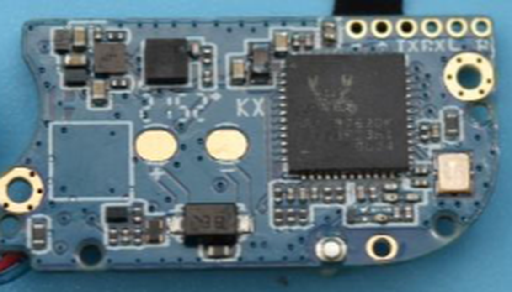
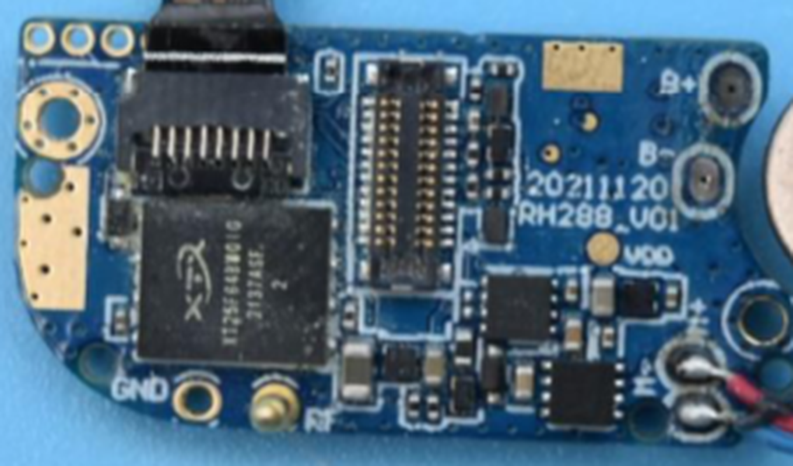
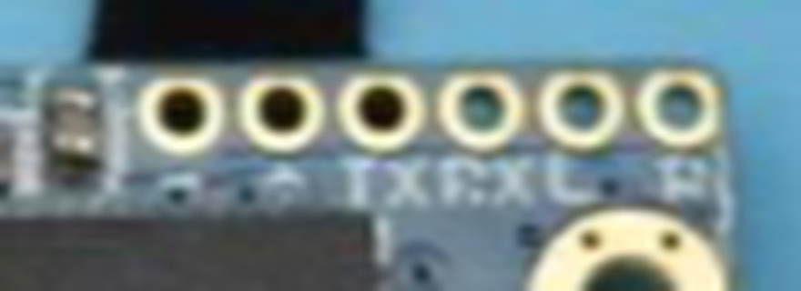
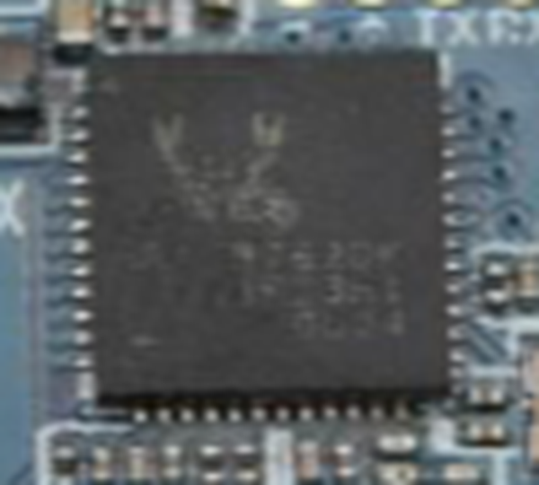
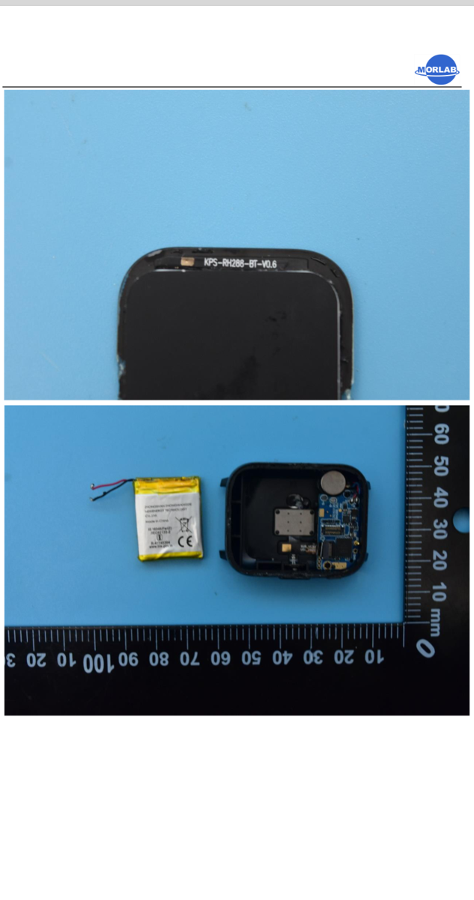
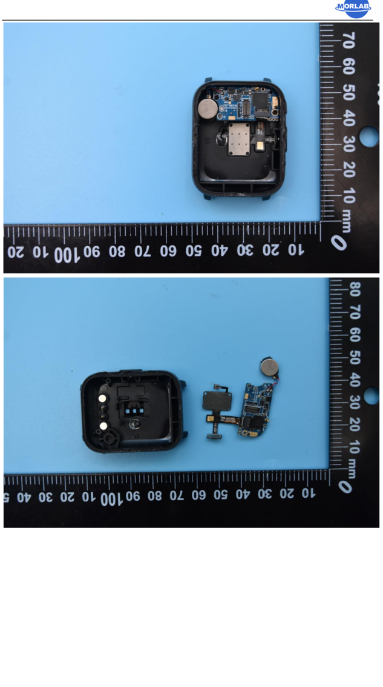

# realme TechLife Watch S100 — Research Notes

Living notes for repurposing a spare TechLife S100 into a custom-firmware desk clock /
car navigation display. Update this file as new information comes in; add an entry to the
[changelog](#changelog) at the bottom each time.

Confidence tags used below: **[confirmed]** = read directly from the device or a primary
source; **[likely]** = strong evidence but not fully verified; **[unverified]** = guess or
secondary source only.

---

## 1. Device identity

| Field | Value | Source |
|---|---|---|
| Marketed name | realme TechLife Watch S100 | Watch "About" screen |
| Model | **RMW2103** | Watch regulatory screen **[confirmed]** |
| Serial number | 2202235621030004230 | Watch regulatory screen |
| Manufacturer | Realme Chongqing Mobile Telecommunications Corp., Ltd. | Watch regulatory screen |
| Stock firmware | **1.3.0.017** | Watch "Software Version" screen **[confirmed]** |
| BLE MAC | `78:02:B7:58:FF:9E` | Watch screen + BLE `ffd2` characteristic **[confirmed]** |
| BLE advertised name | `TechLife Watch S100` | BLE scan **[confirmed]** |
| FCC ID | **2AUYFRMW2103** | FCC filing **[confirmed]** |
| Release | March 2022 | [GSMArena](https://m.gsmarena.com/realme_techlife_watch_s100-11420.php) |
| Companion app | **realme Fit** (not realme Link) | [91mobiles review](https://www.91mobiles.com/hub/realme-techlife-watch-s100-review/), [Geekman review](https://www.geekman.in/realme-techlife-watch-s100-review/) |

---

## 2. Hardware

### 2.1 Summary

| Part | Value | Confidence / Source |
|---|---|---|
| SoC | **Realtek RTL8762-series**; package marking looks like `RTL8762DK` (last letters blurry) | Family **[confirmed]** (BLE services + Realtek logo in FCC photo); exact variant **[likely]** |
| External flash | **XTX XT25F64B** (64 Mbit = 8 MB SPI NOR) — probably watch faces / fonts / images | **[likely]** (FCC photo marking) |
| Main board | `RH288_V01`, dated `20211120` | **[confirmed]** (FCC photo silkscreen) |
| Display module | Label `KPS-RH288-BT-V0.6`; 1.69" IPS **LCD**, 240×280, ~218 ppi, 530 nits | Label **[confirmed]** (FCC photo); specs from [GSMArena](https://m.gsmarena.com/realme_techlife_watch_s100-11420.php) |
| Display controller | Unknown (likely an ST7789-class SPI/QSPI driver for 240×280) | **[unverified]** |
| Touch | Yes (capacitive) | Observed |
| Buttons | 1 side button | Observed |
| Battery | 260 mAh Li-ion (pouch, soldered wires to B+/B− pads) | [GSMArena](https://m.gsmarena.com/realme_techlife_watch_s100-11420.php) + FCC photo |
| Sensors | Accelerometer, PPG heart rate / SpO2 (sensor flex labeled `SUB_VC32R21`, `C2151`), skin/body temperature | GSMArena + FCC photo + watch menus |
| Vibration | Coin vibration motor | FCC photo |
| Charging | 2 pogo pins on case back → appear to be **charging only** | **[likely]** (FCC photo shows them in the case, not on the UART header) |
| Radio | BLE, 2402–2480 MHz | FCC grant **[confirmed]** |

### 2.2 Test pads (critical for recovery)

From the FCC internal photos (main board, SoC side):

- A row of **6 through-hole pads** along the board edge next to the SoC. Silkscreen under
  them reads approximately **`• TX RX L … P`**. **[likely]**
  - `TX` / `RX` → SoC UART (factory programming / log port).
  - `L` → probably the Realtek **LOG** pin (P0_3), which selects ROM "MP mode" when held
    low at power-on. **[unverified — must confirm on real board]**
  - `P` → possibly power/VBAT. **[unverified]**
- Separate labeled pads: **`GND`**, **`VDD`**, **`B+`**, **`B−`** (battery), `RF` (antenna feed).
- 3 small pads at the top-left on the other side of the board (purpose unknown).

> ⚠️ Pad mapping must be confirmed with a close-up photo of the actual board and a
> multimeter **before** soldering anything. Logic level expected to be **3.3 V**.

### 2.3 Disassembly notes (from FCC photos)

- Opens from the **front**: the display is glued to the case (adhesive residue visible).
- Order: display → battery (under display) → main board + sensor flex.
- Display ribbon/board-to-board connector sits on the main board — find it before fully
  lifting the screen.

### 2.4 FCC photo crops

| | |
|---|---|
|  |  |
| Board — SoC side, 6-pad header top right | Board — flash side, `RH288_V01`, GND/VDD/B+/B− |
|  |  |
| 6-pad header, silkscreen `TX RX L … P` | SoC marking (Realtek logo, `…8762?K`) |
|  |  |
| Display label `KPS-RH288-BT-V0.6`, battery, open case | Board in case; board removed with sensor flex |

---

## 3. FCC filing (2AUYFRMW2103)

| Field | Value |
|---|---|
| Grantee | Realme Chongqing Mobile Telecommunications Corp., Ltd. (grantee code 2AUYF) |
| Device description | Smart Watch with BT |
| Equipment class | JBP — Part 15 Class B Computing Device Peripheral; DTS (15C) |
| Frequency / output | 2402–2480 MHz, 0.0012 W |
| Grant date | 2022-04-01 (TCB: PHOENIX TESTLAB GmbH) |
| Test firm | Shenzhen Morlab Communications Technology Co., Ltd. |
| Short-term confidentiality | Yes, until 2022-09-29 (internal/external photos now public) |
| Long-term confidentiality | Yes — **Block Diagram, Schematics, Operational Description, BOM are confidential** (metadata only) |

Public exhibits: User Manual, **Internal Photos**, External Photos, Label, Test Setup Photos,
test reports (EMC, BLE DTS, RF exposure), cover letters.

Links (open in a browser; they block automated fetches):
- https://fcc.report/FCC-ID/2AUYFRMW2103
- https://fccid.io/2AUYFRMW2103

---

## 4. BLE / GATT profile (stock firmware 1.3.0.017)

Read-only dump taken 2026-10-28 with `bleak` from Windows. MTU negotiated: **247**.

| Service | Characteristics (properties) | Notes |
|---|---|---|
| `1801` Generic Attribute | `2a05` (indicate) | Service Changed |
| `1800` Generic Access | `2a00` (read) = `TechLife Watch S100`; `2a01` (read); `2a04` (read) = all zeros; `2aa6` (read) = `00` | |
| `000055ff-…` Vendor | `33f1` (write, read); `33f2` (notify) | realme private app protocol **[likely]** |
| `0000180f` Battery | `2a19` (notify, read) = `0x5c` (92 %) | |
| **`0000d0ff-3c17-d293-8e48-14fe2e4da212`** Realtek OTA | `ffd1` (write-no-rsp) — enter-OTA; `ffd2` (read) BD addr; `ffd3` (read); `ffd4` (read); `ffd5` (read, empty); `ffd8` (write-no-rsp); `fff1` (read); `fff2` (write); `ffe0` (read); `fff3` (read) | Normal-mode OTA service |
| `000056ff-…` Vendor | `34f1` (write-no-rsp, read); `34f2` (notify) | realme private protocol **[likely]** |
| **`00006287-3c17-d293-8e48-14fe2e4da212`** Realtek DFU | `6387` (write-no-rsp) data; `6487` (write, notify) control point | DFU service is **already exposed in normal firmware** |

No Nordic UART Service (`6e400001-…`) — the `openwearota uart` bridge has nothing to talk to on stock firmware.

### 4.1 Realtek OTA info characteristic values (raw)

| Char | Raw bytes | Interpretation |
|---|---|---|
| `ffd2` | `78 02 b7 58 ff 9e` | BD address **[confirmed]** |
| `ffd3` | `00 f0 0e 58` | Patch version **[likely]** |
| `ffd4` | `00 70 52 00` | App version **[likely]** |
| `ffd5` | (empty) | Patch-extension version |
| `ffe0` | `01 00 00 01 00 20 00 00 00 f0 0e 58 00 70 52 00` | Device info block; bytes 8–15 repeat ffd3+ffd4. Fields 0–7 (IC type / OTA spec version / mode flags incl. AES) **not yet decoded** |
| `fff1` | `09 01 00 07 00 08 00 00 f0 0f 00 00` | Image/section info **[undecoded]** |
| `fff3` | `12 00` | **[undecoded]** |

> Decoding `ffe0` would tell us whether the OTA path requires AES and which Realtek OTA
> spec generation is in use. Needs the matching Realtek SDK / Android DFU library source.

---

## 5. Stock firmware features (observed)

- Watch faces ("Dial"), Brightness, **Screen Timeout**, Vibration Strength, Do Not Disturb,
  Raise to Wake. **No always-on display option.**
- Music control page: prev / play-pause / next + volume (shows "Not connected" until paired).
- Notifications (read/clear only, no reply), weather, heart rate (with history graph),
  SpO2, skin/body temperature, sleep, steps/kcal/active minutes, workouts, breathing,
  timer, stopwatch, alarm, flashlight, camera remote, find phone.
- Quick panel: DND, brightness, raise-to-wake, flashlight, settings.

---

## 6. OpenWearOTA status for this watch

- `openwearota` detects it as **`realsil` (RealSil RTL876x)** via DFU service `6287`. **[confirmed]**
- `identify_realsil_chip()` returns nothing (no model ID).
- **Do NOT flash this watch with OpenWearOTA.** Current RealSil driver limitations
  (`openwearota/drivers/realsil.py`):
  1. Always does phase-1 handover (writes `0x01` to `ffd1`) then returns False, asking for
     `--limit-function` — but the CLI has **no such flag**. On this watch the DFU service is
     already present in normal mode, so phase 1 is likely unnecessary.
  2. `START_DFU` metadata is sent **unencrypted**; Realtek SDK uses AES-256-ECB (default key
     in DOCUMENTATION.md §7.5). A realme production device may require AES and/or a
     per-product key / signed image.
  3. The >100 KB "big image" skip (DOCUMENTATION.md §7.8) is not implemented.
- There is no BLE way to back up the stock firmware → any BLE flash is effectively irreversible.

---

## 7. Software ecosystem research

| Topic | Finding | Source |
|---|---|---|
| Gadgetbridge support | **None found** for realme / Dizo watches | Gadgetbridge site/search |
| Gadgetbridge navigation | Works only on some watches (PineTime/InfiniTime, Bangle.js, Fossil); OsmAnd via API, Google Maps via parsing its persistent notification (disable Maps "Live Updates"); text only, no map | [Gadgetbridge navigation docs](https://gadgetbridge.org/basics/integrations/navigation/), [Espruino forum](https://forum.espruino.com/comments/16419406/incontext) |
| Custom firmware for RTL8762 watches | **None published** | Web search |
| RTL8762 dev resources | Vendor SDK (registration); GCC examples [cyber-murmel/rtl8762c-gcc-examples](https://github.com/cyber-murmel/rtl8762c-gcc-examples); BLE-UART example [wuwbobo2021/rtl8762c-ble-uart](https://github.com/wuwbobo2021/rtl8762c-ble-uart); UART programmer [wuwbobo2021/rtltool](https://github.com/wuwbobo2021/rtltool) (RTL8762C; D support unknown) | GitHub |
| ROM programming mode | LOG pin (P0_3) held **low at power-on** → ROM "MP mode"; programmed over UART with Realtek MPTool (Debug mode enabled via RegistrySet.exe) | [RTL87x2x Quick Start Guide](https://www.manualslib.com/guide/4427583/rtl87x2x-quick-start-user-guide.html) |
| Flash read-back / backup procedure | **Not found documented** — must be verified hands-on | — |
| Related reverse-engineering (other chips) | FitPro LT715 / Telink TLSR8232 full RE + custom FW: [e-labInnovations/FitPro-LT715-TLSR8232](https://github.com/e-labInnovations/FitPro-LT715-TLSR8232); $3 Telink watch MicroPython port ([Hackaday](https://hackaday.com/2024/06/26/3-smartwatch-can-run-python)); ATCwatch for nRF52 Da Fit watches ([CNX](https://www.cnx-software.com/?p=78937)) | — |
| Misattributed chip | One spec site lists MediaTek MT2523 — **wrong** (BLE + FCC photos show Realtek) | [Digit](https://www.digit.in/wearable-devices/realme-techlife-watch-s100-price-286825.html) |

---

## 8. Project goals

Custom firmware (stock firmware is expendable) providing:

1. Always-on clock / "desktop buddy" face (time, date, weather, phone battery).
2. Car navigation display: turn arrow, distance in km, street name, ETA / remaining distance.
3. Speed display (km/h from phone GPS).
4. Music controls (play/pause, next/prev, volume).
5. Notifications.
6. Built-in BLE UART console + BLE OTA so later updates don't need wires.
7. *(Stretch)* Low-res mini-map streamed from the phone.

Architecture: watch firmware (C, Realtek RTL8762 SDK, GCC) + Android companion app (Kotlin)
reading Google Maps/OsmAnd navigation, GPS speed, media session and notifications, sending
compact packets over BLE.

Constraints: LCD → always-on means backlight on → hours, not days, on 260 mAh; intended
use is on a dock / car charger. Mount out of direct sun; don't charge in a hot parked car.

---

## 9. Safety plan — gates before any write

**Rule: nothing is written to the watch until (1) the ROM bootloader answers over wires and
(2) a full flash backup has been dumped, verified, and successfully restored.**

| # | Step | Read-only? | Stop if… | Status |
|---|---|---|---|---|
| 0 | No BLE writes (`ffd1`, `6387`, `6487`, OpenWearOTA flash) | — | — | ✅ in effect |
| 1 | Open from the front (heat, plastic tools, mind display flex & battery); photograph both board sides | Yes | Screen/flex tears | ☐ |
| 2 | Identify TX / RX / LOG / GND pads; measure logic level = 3.3 V | Yes | Pads can't be identified | ☐ |
| 3 | Wire 3.3 V USB-UART (CP2102 preferred): adapter TX→watch RX, RX→TX, GND→GND; **don't** connect adapter VCC while battery attached | Yes | — | ☐ |
| 4 | Hold LOG low at power-on → confirm ROM MP mode responds (rtltool / MPTool) | Yes | No response | ☐ |
| 5 | Dump full flash **twice**, compare hashes, store 2 copies; restore it and confirm stock boots | Restore writes identical data | Read blocked / restore fails → **no custom FW** | ☐ |
| 6 | Custom firmware, flashed over UART first; BLE OTA only once proven | No | — | ☐ |

Tools needed: 3.3 V USB-UART adapter (CP2102/CH340, ~₹150–300), multimeter, fine soldering
iron + 30 AWG / enameled wire, plastic pry tools, hair dryer / gentle heat.

---

## 10. Entry points (how to reproduce)

All commands run from the repo root in PowerShell, with the watch **disconnected from the
phone** (close realme Fit / turn phone Bluetooth off) and within ~1 m of the PC.

### 10.1 Environment setup (Windows)

Host system used for all work so far:

| Item | Value |
|---|---|
| OS | Windows 11 Home Single Language, build 10.0.26300 |
| Python | 3.12.10 (venv at `.venv/`) |
| BLE stack | Built-in laptop Bluetooth via WinRT; `bleak` 3.0.2 |
| Shell | PowerShell 5.1 (Git Bash also available) |
| Repo path | `C:\Users\salma\OneDrive\Desktop\techbysh\OpenWearOTA` |

```powershell
cd C:\Users\salma\OneDrive\Desktop\techbysh\OpenWearOTA
python -m venv .venv                      # Python 3.12.10 used
.\.venv\Scripts\python.exe -m pip install -e .   # installs openwearota + bleak 3.0.2
# one-time, to allow venv activation scripts:
Set-ExecutionPolicy -Scope CurrentUser -ExecutionPolicy RemoteSigned
.\.venv\Scripts\Activate.ps1
```

If activation is blocked, call `.\.venv\Scripts\openwearota.exe` / `.\.venv\Scripts\python.exe` directly.

### 10.2 Read-only commands (safe on stock firmware)

| Purpose | Command | Writes to watch? |
|---|---|---|
| BLE scan (find MAC, RSSI) | `openwearota scan` | No |
| Chipset detection | `openwearota` → `1` (Flash firmware) → pick watch → **press Enter at the firmware prompt to cancel** | No (connect + read services only) |
| Full GATT dump + Realtek OTA info | `python tools/s100_gatt_dump.py` (optional MAC argument) | No (reads only; no notify/pair) |

### 10.3 Commands that must NOT be used on this watch (yet)

| Command / action | Why |
|---|---|
| `openwearota flash 78:02:B7:58:FF:9E <file>` or typing `YES` in the interactive flash flow | Would write `0x01` to `ffd1` (reboot into OTA) and attempt an unverified RealSil DFU — no backup exists |
| Any write to `ffd1`, `ffd8`, `fff2`, `6387`, `6487` | Realtek OTA/DFU control — can start an update |
| Writes to `33f1` / `34f1` | realme private protocol — unknown effects |
| Connecting anything to the 2 charging pins other than the stock charger | Unknown wiring |

### 10.4 Key UUIDs

| Role | UUID |
|---|---|
| Realtek OTA service (normal mode) | `0000d0ff-3c17-d293-8e48-14fe2e4da212` |
| Enter-OTA (write `0x01`) — **don't** | `0000ffd1-0000-1000-8000-00805f9b34fb` |
| Realtek DFU service | `00006287-3c17-d293-8e48-14fe2e4da212` |
| DFU data / control point | `00006387-…` / `00006487-3c17-d293-8e48-14fe2e4da212` |
| realme private protocol | `000055ff-…` (`33f1` w/r, `33f2` notify), `000056ff-…` (`34f1` w/r, `34f2` notify) |

---

## 11. Watch interaction log

Every action performed against the physical watch. **Changes to the watch so far: none** —
all interactions have been read-only (connect, service discovery, characteristic reads).
Stock firmware 1.3.0.017 is untouched.

| Date | Action | Entry point | Result | Changed watch? |
|---|---|---|---|---|
| 2026-10-28 | BLE scan | `openwearota scan` | Found `TechLife Watch S100` `78:02:B7:58:FF:9E` at −82 dBm, then −58 dBm when moved closer | No |
| 2026-10-28 | Chipset detection | `openwearota` → 1 → select watch → cancelled at firmware prompt | Connected; detected **RealSil (RTL876x)**; no model ID | No |
| 2026-10-28 | GATT service dump | ad-hoc bleak script (now `tools/s100_gatt_dump.py`) | Service table in §4; MTU 247 | No |
| 2026-10-28 | Realtek OTA info reads | ad-hoc bleak script (now `tools/s100_gatt_dump.py`) | Raw values in §4.1; battery 92 % | No |
| 2026-10-28 | Verification run of the dump tool | `python tools/s100_gatt_dump.py` | Identical values to the earlier reads; battery still 92 % | No |
| 2026-10-28 | Photos of watch menus / exterior by user | — | Stock features in §5 | No |
| — | Attempted execution-policy change by assistant | `Set-ExecutionPolicy` | Blocked by Claude Code permission system; user to run it | No (PC only) |

> Add a row for **every** future interaction, especially anything that writes (flash
> dumps, restores, firmware flashes). Note the exact command, file names/hashes, and outcome.

---

## 12. Repository changes made during this work

Changes to OpenWearOTA itself (PC-side code; nothing to do with the watch's contents). Uncommitted as of 2026-10-28.

| File | Change |
|---|---|
| `openwearota/cli.py` | Fixed OnMicro import (`.drivers.onmicro` → `.drivers.omnicro`) that crashed every flash |
| `openwearota/cli.py` | `cmd_flash_direct` now unpacks `(family, chip_id)` from `_detect_and_report` (flash subcommand never reached a driver) |
| `openwearota/cli.py` | `_list_prebuilts` looks in `prebuilts/<family>/` (CWD and repo root) instead of a name built from `FAMILY_NAMES` |
| `openwearota/cli.py` | `main()` reconfigures stdout/stderr to UTF-8 (Windows cp1252 crash on ⚠ ✓ ▓ ─ when output is redirected) |
| `openwearota/cli.py`, `openwearota/__init__.py` | `--version` reads `__version__`; version aligned to `0.0.1a2` (matches `pyproject.toml`) |
| `openwearota/detect.py` | RealSil SDK note no longer claims DFU is unimplemented; points to DOCUMENTATION.md §7 |
| `tools/s100_gatt_dump.py` | New read-only GATT/OTA-info dump tool for this watch |
| `docs/TechLife-S100.md`, `docs/img/techlife-s100/` | These notes + FCC photo crops |

Known remaining issues (not fixed): RealSil driver limitations in §6; PhyPlus is reached via
`shb_slb` / `SHB_OTA` (by design, see DOCUMENTATION.md §3).

---

## 13. Open questions

- [ ] Exact SoC variant (RTL8762C vs D vs other) — read marking on the real chip.
- [ ] Exact pad mapping of the 6-pad header (`TX RX L … P`).
- [ ] Does ROM MP mode respond? Which tool (rtltool vs Realtek MPTool) supports this variant?
- [ ] Can the internal + external flash be read back (read protection / secure boot)?
- [ ] Display controller IC and interface (SPI/QSPI/8080), touch controller IC, button GPIO.
- [ ] Decode `ffe0` / `fff1` OTA info (AES required? OTA spec version?).
- [ ] Longest stock Screen Timeout value (useful as zero-risk desk clock).

---

## Changelog

- **2026-10-28** — Initial notes: BLE scan/detect, GATT dump + OTA info values, stock feature
  survey from photos, FCC filing + internal photo analysis (SoC, flash, board ID, UART pads),
  ecosystem research, goals and safety gates.
- **2026-10-28** — Added entry points (§10), watch interaction log (§11), repo change list
  (§12); added `tools/s100_gatt_dump.py`.
- **2026-10-28** — Added host system details (§10.1). Repo re-initialised with fresh history and
  pushed to https://github.com/salmanulharis/smartwatch-customisation (upstream:
  HackSucks/OpenWearOTA; old `.git` backed up locally). `.gitignore` added; `dist/` and
  `*.egg-info/` build artifacts no longer tracked.
